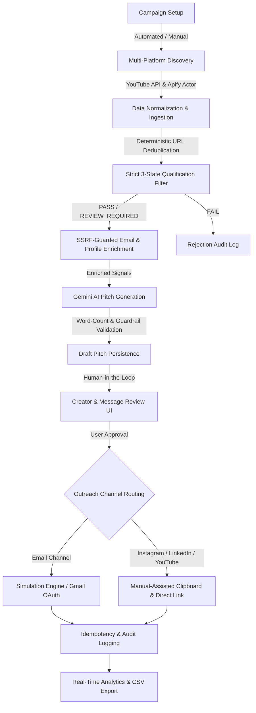

# MicroReach AI — End-to-End Automation & Outreach Workflow

This document details the complete end-to-end operational pipeline of MicroReach AI, categorizing each workflow stage by its degree of automation, error-handling mechanisms, and external integration points.

---

## 1. Workflow Architecture Overview

MicroReach AI is engineered as an enterprise-grade pipeline that combines automated data ingestion and AI synthesis with human-in-the-loop review gates to ensure data integrity and compliance with platform terms of service.

---

## 2. Stage-by-Stage Automation Breakdown

| Stage | Degree of Automation | Participating Services | Description & Failure Handling |
|---|---|---|---|
| **1. Discovery** | **Fully Automated** | YouTube Data API v3, Apify Instagram Scraper Actor | Ingests micro-creators matching campaign keywords and niche tags. On API rate limit or actor timeout, gracefully saves partial candidate batches and logs failure telemetry. |
| **2. Normalization & Deduplication** | **Fully Automated** | Server-side Express Ingestion Services | Normalizes usernames, handles, and canonical profile URLs. Rejects duplicates using unique URL constraints and deterministic idempotency hashes. |
| **3. Qualification & Filtering** | **Fully Automated** | Rule-Based Qualification Engine (`server/services/filtering/`) | Classifies creators into `PASS`, `FAIL`, or `REVIEW_REQUIRED` against exact campaign follower bounds (5K–100K), engagement threshold ($\ge 2.0\%$), and country signals. Unknown metrics safely trigger `REVIEW_REQUIRED`. |
| **4. Profile Enrichment** | **Fully Automated** | Email Enrichment Service with SSRF Security Guard | Scrapes public channel descriptions and linked websites for contact emails. Blocks private, loopback, and CGNAT IP addresses. Marks unconfirmed emails as `unverified` and missing as `Not Found`. |
| **5. AI Personalization** | **Fully Automated** | Google Gemini Developer API (`gemini-3.6-flash`, `gemini-3.1-flash-lite`, `gemini-3.5-flash`) | Constructs context-rich prompts using verified niche, bio snippets, and content themes. Enforces strict length bounds (Email: 60–90 words, IG DM: 15–30 words, LinkedIn: 20–75 words). Re-prompts or truncates if length bounds are violated. |
| **6. Message Review & Approval** | **Manual (Human-in-the-Loop)** | Dashboard Review UI (`src/components/dashboard/`) | Evaluator or brand manager inspects the generated pitch, creator fit score, and channel availability. Editing, regenerating, or approving the message is performed before transmission. |
| **7. Outreach Transmission** | **Partially Automated / Simulation** | Outreach Service, Google Gmail API, Clipboard Router | In simulation mode (`OUTREACH_MODE=simulation`), transmission is mocked and logged atomically. For Instagram and LinkedIn, direct links and pre-formatted clipboard copy buttons prevent unauthorized bot messaging. |
| **8. Tracking & Reporting** | **Fully Automated** | Supabase Persistence & Export Controller | Persists simulation logs, status transitions, and timestamps. Generates sanitised, injection-safe CSV exports on demand. |

---

## 3. Resilience and Error Handling Policies

1. **Transient Provider Outages**:
   - Gemini API calls implement bounded exponential backoff (up to 2 retries) with automatic fallback across available Flash models (`gemini-3.6-flash` -> `gemini-3.5-flash` -> `gemini-3.1-flash-lite`).
   - Apify Instagram actor runs use resumable polling with a 60-second execution bound, preventing worker thread exhaustion.
2. **SSRF Guarding on Website Lookups**:
   - All external website lookups resolve DNS before connecting. Connections to private IP subnets (`127.0.0.0/8`, `10.0.0.0/8`, `172.16.0.0/12`, `192.168.0.0/16`, `169.254.169.254`, `100.64.0.0/10`) are immediately aborted with code `400 ssrf_blocked`.
3. **Outreach Safety Lock**:
   - `OUTREACH_MODE=simulation` guarantees that no live emails or messages are sent during system evaluation, while fully updating the UI state and database audit tables.
